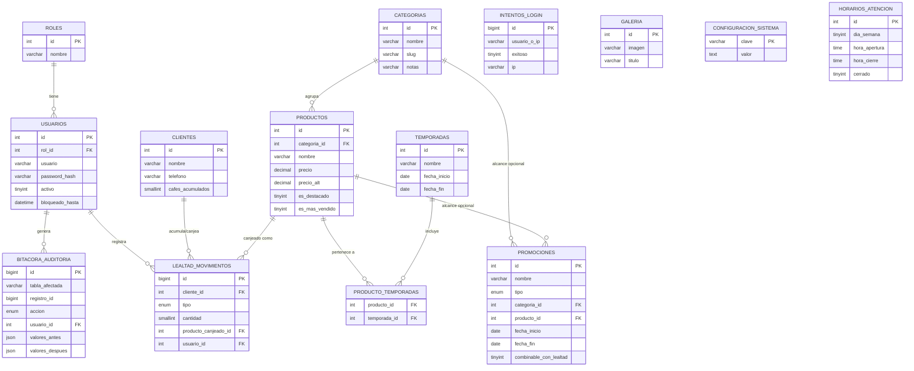

# Modelo de datos — Fase 2

Diagrama entidad-relación del esquema definido en
[`database/schema.sql`](../database/schema.sql), correspondiente a las
decisiones aprobadas en [arquitectura.md](arquitectura.md) (§5 y §10).

`GALERIA` y `CONFIGURACION_SISTEMA` no tienen relaciones con otras tablas
(son independientes), tal como se definió en `arquitectura.md` §5.

## Notas de implementación

- `cafes_acumulados` en `clientes` es una **caché**: la fuente de verdad es
  la suma de `lealtad_movimientos`. Se mantiene sincronizada desde
  `LealtadService` (Fase 5), no se edita directamente desde SQL fuera de
  ese servicio.
- `intentos_login` no lleva llave foránea a propósito: debe poder registrar
  intentos con un usuario que no existe.
- La paleta de colores del negocio (beige/café/verde) **no** está en
  `configuracion_sistema`: es un token de diseño (CSS), no un dato que el
  panel deba editar en tiempo de ejecución.
- Los datos semilla de `schema.sql` usan exclusivamente información real de
  `docs/negocio.md` (menú completo con precios, WhatsApp, Instagram,
  Facebook). Dirección, mapa, calificación de Google y horarios quedan
  vacíos/sin configurar porque aún no se han proporcionado — no se
  inventaron valores de ejemplo.
